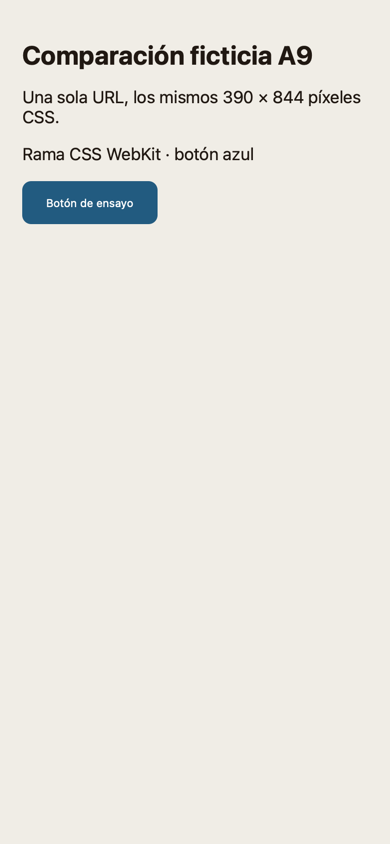
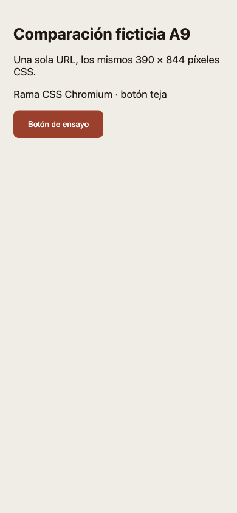

# Demo de `browser_compare`

Se sirvió [una sola página ficticia](pagina.html) en `127.0.0.1:18502` y se abrió con el comparador real, usando
una app de depuración compilada con `BrowserEngine` de AlfalfaKit y un Chromium propio. Ambos motores confirmaron
390 × 844 píxeles CSS y dejaron una captura PNG de ese tamaño. La regla `@supports (hanging-punctuation: first)`
se activó en el WebKit de la demo y no en el Chromium probado: el texto y el color del botón muestran la diferencia.

| WebKit | Chromium |
|---|---|
|  |  |

El [resultado del motor](resultado.json) contiene también la diferencia textual y los errores ficticios de consola
por motor. El ensayo usó el paquete `.tgz` publicado de CuyBrowser 0.5.0 con sus dependencias bloqueadas, homes y
perfiles propios. El helper, el servidor y el Chromium de prueba terminaron al cerrar el ensayo.

Para repetirlo, sirve `pagina.html` desde un proyecto temporal y pide `browser_compare` con su URL y `preset: mobile`
en la app de depuración. Concede sólo los permisos del servidor ficticio y del proceso CuyBrowser que crees para
esa prueba. Los resultados dependen de las funciones CSS que soporten los motores instalados.
