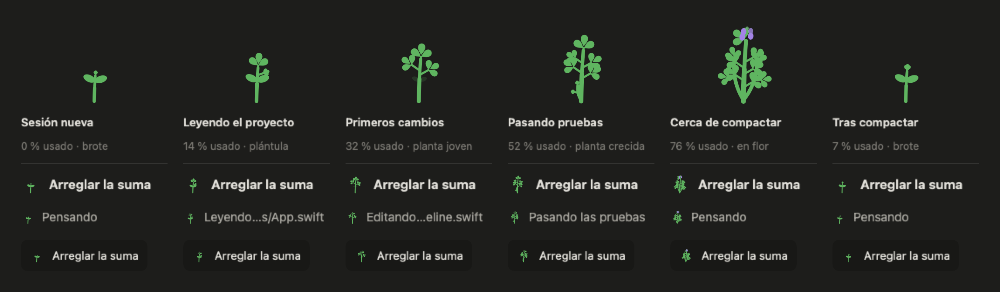
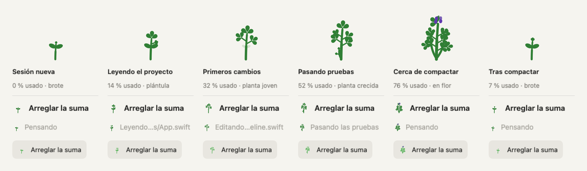
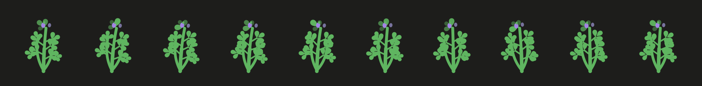
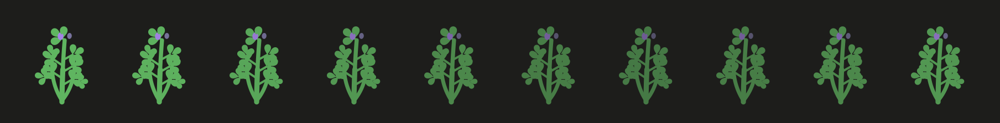

# La alfalfa crece con el contexto

Demo ejecutada el 10 de noviembre de 2026. Un `Timeline` real recibe las líneas
`contexto` del protocolo de una sesión inventada (ventana de 200 000 tokens, umbral
de compactación de 160 000, con `estimado`) y las vistas reales de la app pintan su
alfalfa en cada turno: la grande, la de la cabecera (22 pt), la de la fila viva
(16 pt) y la de la barra lateral (16 pt). El último turno es el que llega tras
compactar: la planta vuelve a ser un brote.

No se arranca `AppModel`, no se abren sesiones del usuario, no se lee el Llavero y no
se abre ninguna ventana (cada vista se pinta en su propia `NSHostingView`). El binario
corre con `HOME`, `CFFIXED_USER_HOME` y `ALFALFA_HOME` en una carpeta temporal y la
demo comprueba que en ese `ALFALFA_HOME` no se escribió nada.





Dos segundos trabajando, un fotograma cada 0,2 s: el tallo se dobla desde la base, las
hojas aletean desfasadas (la brisa sube por la planta) y la hoja de la punta respira.



Con «Reducir movimiento» no hay vaivén ni escala: la planta entera se desvanece suave.



[`etapas.json`](etapas.json) tiene, para cada turno, el % usado que enseña el panel
«Contexto», el % del camino hasta la compactación (lo que hace crecer la planta), la
etapa y cuántas hojas lleva.

Para repetir, desde la raíz del repositorio:

```bash
(cd alfalfa-mac && swift build)
docs/demos/alfalfa-crece/demo.sh
```

Lo que esta demo no enseña: la app entera con una sesión viva. Las capturas salen de
las mismas vistas que usa la app, alimentadas por el mismo `Timeline`, pero la cabecera
y la fila de la barra lateral están montadas a mano en `Demo.swift` con sus medidas.
