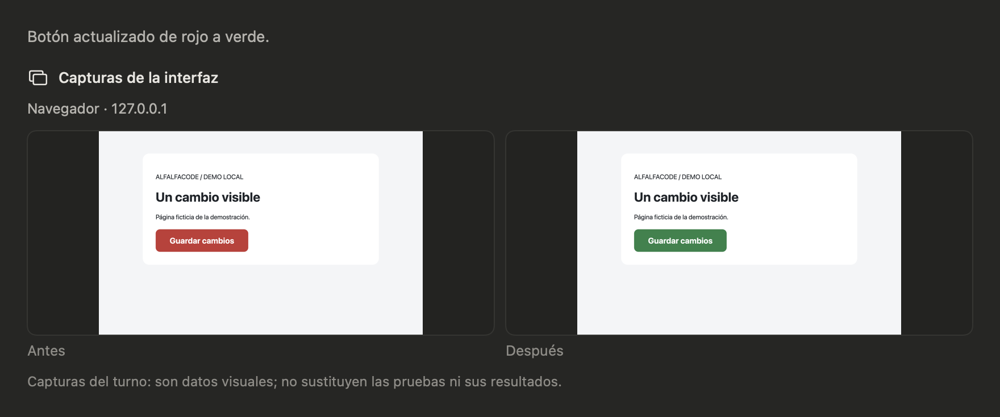

# Capturas de cierre con CuyBrowser

La demo usa CuyBrowser 0.5.0, un perfil propio y dos páginas ficticias
servidas en el Mac. El motor toma el primer antes en `/inicio`. Al editar
el botón en `/`, obtiene un nuevo antes de esa página justo antes de escribir.
El cierre muestra el botón rojo y el verde de la misma página.



Prepara la página en una carpeta temporal y deja el servidor abierto durante
la prueba.

```bash
proyecto_demo="$(mktemp -d /private/tmp/alf-a13-demo-XXXXXX)"
cat > "$proyecto_demo/inicio.html" <<'HTML'
<!doctype html><meta charset="utf-8"><title>Entrada</title>
<h1>Pantalla de entrada</h1>
HTML
cat > "$proyecto_demo/index.html" <<'HTML'
<!doctype html><meta charset="utf-8"><title>Botón ficticio</title>
<link rel="stylesheet" href="/style.css">
<main><h1>Un cambio visible</h1><p>Página ficticia de la demostración.</p>
<button>Guardar cambios</button></main>
HTML
cat > "$proyecto_demo/style.css" <<'CSS'
body { background: #f4f5f7; font: 24px system-ui; }
main { max-width: 780px; margin: 84px auto; padding: 48px; background: white; }
button { background: #c53835; color: white; padding: 24px 52px; border: 0; border-radius: 16px; }
CSS
printf '%s\n' "$proyecto_demo"
python3 - "$proyecto_demo" <<'PY'
import sys
from functools import partial
from http.server import SimpleHTTPRequestHandler, ThreadingHTTPServer

class Pagina(SimpleHTTPRequestHandler):
    def do_GET(self):
        if self.path == '/inicio':
            self.path = '/inicio.html'
        super().do_GET()

    def end_headers(self):
        self.send_header('Cache-Control', 'no-store')
        super().end_headers()

with ThreadingHTTPServer(('127.0.0.1', 18496), partial(Pagina, directory=sys.argv[1])) as servidor:
    servidor.serve_forever()
PY
```

1. Abre una sesión Auto en la carpeta impresa, con **CuyBrowser · Chromium**
   seleccionado en Ajustes ▸ Navegador. Autoriza el arranque del perfil propio
   y el acceso al origen local de la demo.
2. En el mismo turno, pide abrir `http://127.0.0.1:18496/inicio`, abrir
   `http://127.0.0.1:18496/` y leer la página con `browser_read`.
3. Pide leer `style.css`, cambiar `#c53835` por `#278348` con `write_file`,
   recargar explícitamente con `browser_navigate` y cerrar con `wrap_up`.
4. Comprueba que la tarjeta muestre **Antes** en rojo y **Después** en verde
   para el mismo botón. Al reabrir el turno, la tarjeta debe seguir ahí.
   Cierra la sesión y detén el servidor con Ctrl+C.

La ejecución automatizada usó el paquete publicado `.tgz`, el motor real
y la tarjeta Swift de la app de depuración. Verificó el antes de `/inicio`,
el respaldo de `/` antes de escribir, el cambio visual al recargar y las
rutas del par persistidas en el cierre y el historial.
