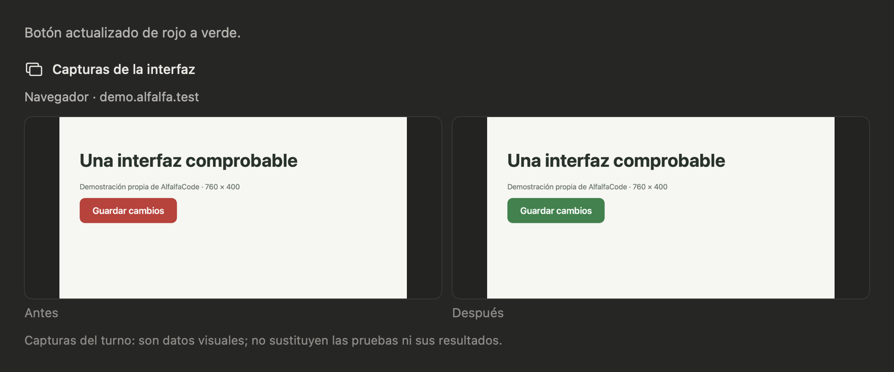

# A13: capturas antes y después

Demo ejecutada el 10 de noviembre de 2026. Cambia el color de un botón de rojo a
verde en una página propia, cargada por un `BrowserEngine` real de WebKit.
El motor Python abre y cierra un turno con el proveedor sustituido y adjunta las
dos capturas al cierre. `InterfaceProofCard` y la galería reales de la app muestran
la comparación. La imagen de la tarjeta se obtiene de su propia `NSHostingView`,
nunca del escritorio ni de otra app.

No se arranca `AppModel`, no se abren sesiones del usuario y no se lee el Llavero.
El `conftest` de la suite aísla proveedores, hogares y configuraciones. Todo el
proyecto y el hogar del ensayo están en una carpeta temporal. No hay servidor
ni peticiones a un sitio real: WebKit carga el HTML incluido en esta carpeta.



- [Antes](antes.png) y [después](despues.png), PNG generados por WebKit.
- [HTML inicial](antes.html) y [HTML final](despues.html).
- [Datos del cierre](cierre.json); las rutas temporales se sustituyen por los
  nombres de las imágenes de esta carpeta al guardar la evidencia de la demo.

Para repetir, desde la raíz del repositorio, con el entorno de desarrollo instalado:

```bash
(cd alfalfa-mac && swift build)
PYTHONPATH=. python -m pytest -p tests.conftest docs/demos/interfaz-a13/demo.py -q
```

`demo.py` compila `Demo.swift` con los objetos de AlfalfaKit y las vistas de la app
del worktree actual. La demo comprueba que el cierre esté completo y que los PNG
sean distintos. Hay que mirar también la tarjeta generada: una diferencia de bytes
no demuestra por sí sola que el aspecto sea correcto.

El cierre registra lo que se vio; no vuelve a cargar la página, no ejecuta una
revisión visual con un modelo ni declara las pruebas aprobadas. La parte de Mac
reutiliza las capturas que ya pidieron las herramientas y se prueba con imágenes
sintéticas; esta demo visual usa WebKit. No se añaden emuladores.
