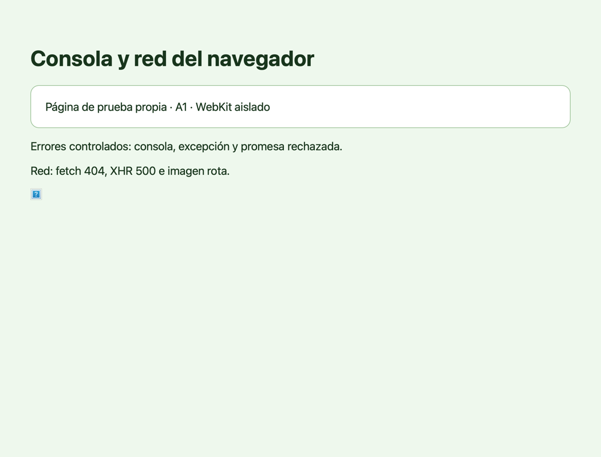

# A1: consola y red

Demo ejecutada el 9 de noviembre de 2026 con una app de depuración AppKit compilada contra
los objetos reales de AlfalfaKit del worktree. La app sólo instancia `BrowserEngine` y una ventana:
no arranca el motor, no abre sesiones, no accede al Llavero ni a preferencias de AlfalfaCode.

La página propia, servida en `127.0.0.1:18461`, emite `console.error`, una excepción con `setTimeout`
y un rechazo de promesa. También pide `/404?token=secreto-demo&pagina=2` mediante fetch, `/500`
mediante XHR y una imagen rota. Todos los valores son inventados.

- `consola` devolvió los tres mensajes con niveles `error`, `exception` y `unhandledrejection`.
- `red` observó las peticiones con estados 404 y 500 y el fallo de imagen.
- La respuesta real de `red`, procesada por `Navegador.llamar(..., 'browser_network', {})`, aparece en
  [navegador-a1-red.json](navegador-a1-red.json): el parámetro `token` está oculto, `pagina=2` se conserva.
- La captura es exclusivamente del WKWebView de nuestra app de depuración, hecha con su acción `captura`.
  No hay imágenes de otras apps ni de sesiones del usuario.

Las pruebas reproducibles de consola, errores, reinicio, topes, fetch, XHR y recursos están en
`BrowserDiagnosticsTests.swift`. Las de formato, modos y redacción están en
`tests/test_navegador_diagnosticos.py`.

Límites: se instrumenta el documento principal; no es un HAR ni un registro completo de tráfico de
workers, marcos o mecanismos que la página sustituya. Los mensajes de consola pueden contener cualquier
texto que la propia página escriba. Se devuelven como datos no fiables, nunca como instrucciones.
