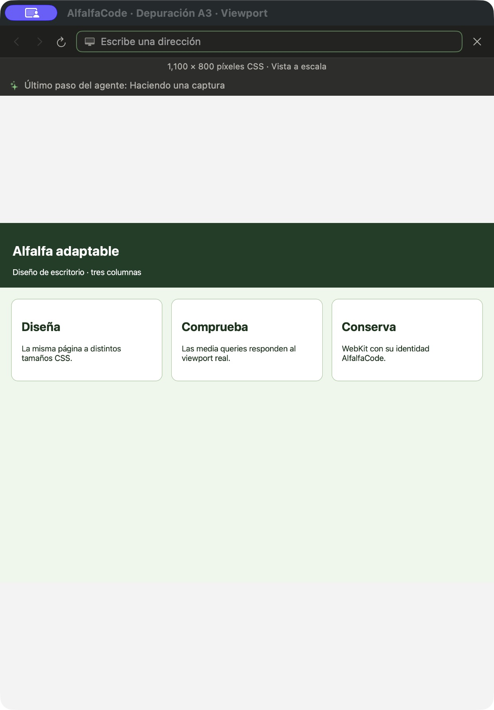
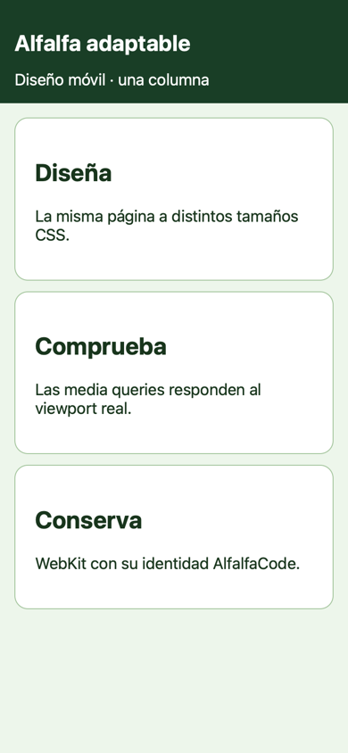
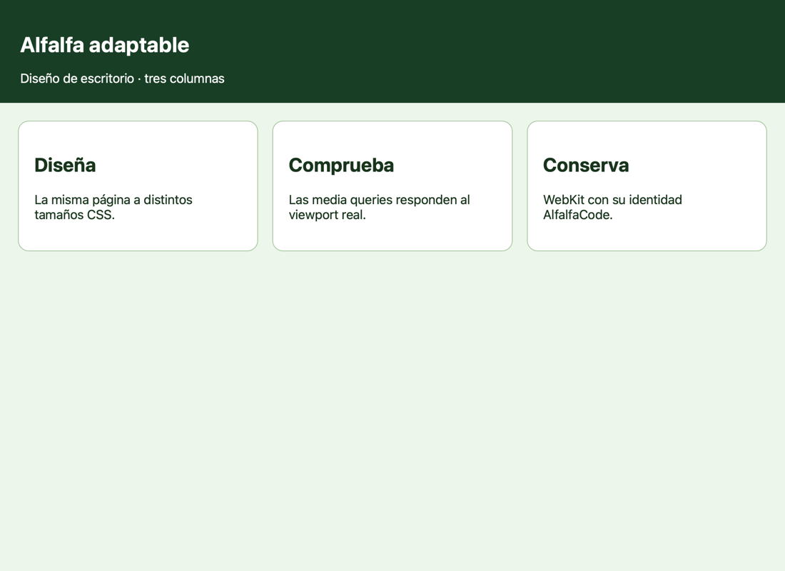

# A3: viewport y diseño adaptable

Demo ejecutada el 9 de noviembre de 2026 en una app de depuración compilada contra `BrowserPane`,
`Theme` y los objetos reales de AlfalfaKit. Tiene un bundle propio
(`com.cuycoders.alfalfacode.fase1a3`), hogar temporal y un stub de terminal que no ejecuta nada.
No arranca `AlfalfaApp`, `AppModel` ni el motor; no toca el Llavero ni sesiones del usuario.

La página propia se sirvió en `127.0.0.1:18463`. Se mostraron secuencialmente los tamaños 390×844 y
1100×800 en el mismo panel. El tamaño fijo se escala para caber en el espacio disponible.

En [navegador-a3.jsonl](navegador-a3.jsonl) se guardan las respuestas reales de WebKit:

- `innerWidth=390`, `innerHeight=844` y media query móvil verdadera.
- `innerWidth=1100`, `innerHeight=800` y media query móvil falsa.
- El mismo `navigator.userAgent`, con `AlfalfaCode`, en ambas medidas.

Las capturas son exclusivamente del WKWebView de la app de depuración mediante `captura`.
La página cambia de una a tres columnas; no se cambia el agente de usuario ni se imita un dispositivo.

La lectura de accesibilidad de la app confirmó «1,100 × 800 píxeles CSS · Vista a escala».
Esta captura CUA muestra exclusivamente nuestra ventana de depuración con el panel real:

Pruebas reproducibles: `BrowserViewportTests.swift` (dimensiones reales, media queries, identidad y límites)
y `tests/test_navegador_viewport.py` (presets, tamaño propio, argumentos inválidos y los cinco modos).

La verificación combinada con la anotación A4 usó un panel de 420×760. El redondeo de AppKit al escalar
podía dejar el WKWebView en 389,97 píxeles y cambiar un breakpoint. El contenedor nativo restablece el
tamaño CSS tras cada layout y fija sus constraints de ancho y alto. El resultado real guardado en
[navegador-a3-integracion.json](navegador-a3-integracion.json) confirma 390×844 y 1100×800 exactos,
también al abrir y retirar la tarjeta de comentario. Las cuatro selecciones de botón/área se conservaron.
